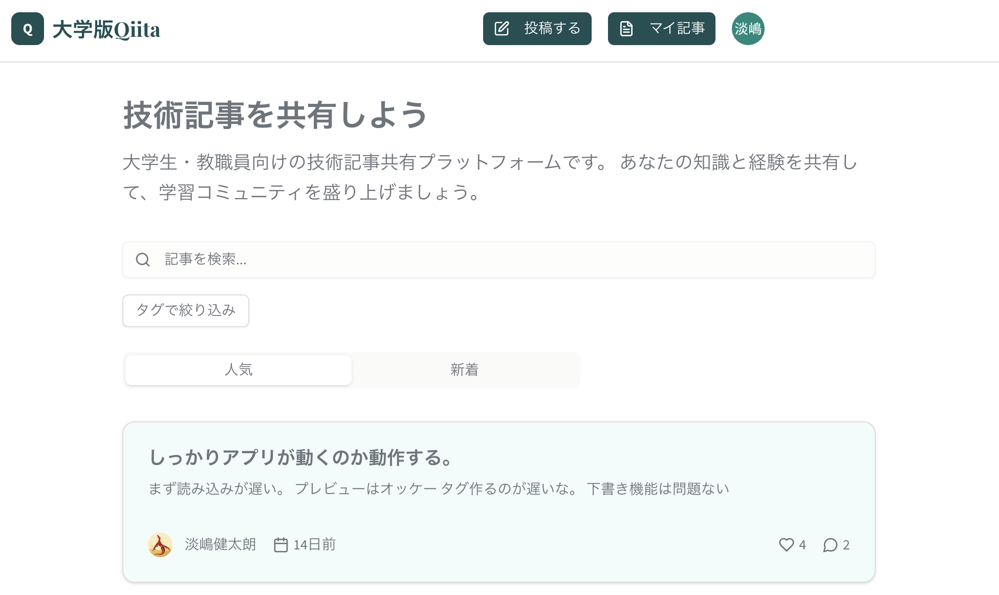

大学生・教職員向けの技術記事共有プラットフォームです。記事の投稿や自分の記事の管理、検索、タグによる絞り込みを扱う画面を用意しています。

2025年8月、約10日間で制作。初めての長期インターンの後、そこで使われていた技術を学び直すために取り組みました。

[Demoを開く](https://campus-qiita-frontend.vercel.app/)

[Frontendのコードを見る](https://github.com/awashimakentaro/campus-qiita-frontend)

[Backendのコードを見る](https://github.com/awashimakentaro/campus-qiita-backend)
