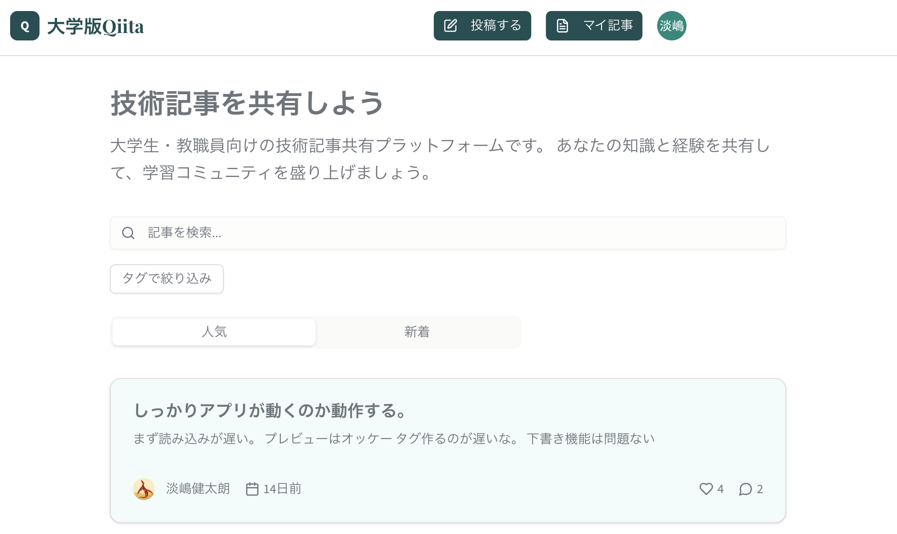

<!-- page:contents -->

[01　作品について](#about)

[02　課題・背景・目標](#context)

[03　制作プロセス](#process)

[04　検証・改善](#review)

[05　成果と効果](#outcome)

[06　使用技術・ツール](#tools)

<!-- page:about -->

大学生・教職員向けの技術記事共有プラットフォームです。記事の投稿や自分の記事の管理、検索、タグによる絞り込みを扱う画面を用意しています。

2025年8月、約10日間で制作。初めての長期インターンの後、そこで使われていた技術を学び直すために取り組みました。

[Demoを開く](https://campus-qiita-frontend.vercel.app/)

[Frontendのコードを見る](https://github.com/awashimakentaro/campus-qiita-frontend)

[Backendのコードを見る](https://github.com/awashimakentaro/campus-qiita-backend)

<!-- page:context -->

## 実務での悔しさを、学ぶきっかけに

初めて参加した長期インターンを、技術力の不足で短期間で終えた後に制作したアプリです。悔しさから、何か一つでも学んで次につなげたいと考えました。

インターン先で目にしたソースコードや技術構成を読み、同じ技術を自分の制作で使ってみました。

## 技術記事を共有する場を題材に

大学生・教職員が知識や経験を共有する記事サービスを題材に、フロントエンドとバックエンド、データベースを組み合わせました。

当時はコードの理解が十分ではありませんでした。使われている技術を試し、開発の流れを少しずつ知ることが、この制作の中心でした。

<!-- page:process -->

## 実務で見た構成を、自分で試す

フロントエンドはNext.js／React、バックエンドはPython／FastAPIを使い、別々のリポジトリで管理しました。

データベースにはPostgreSQLを利用し、SQLAlchemyとAlembicを使った構成を取り入れています。DockerやGitなど、業務で見た開発の基本にも触れました。

## 記事を読み、書く導線

画面には、投稿、自分の記事、記事検索、タグによる絞り込みを配置しました。記事一覧では人気・新着を切り替える構成です。

機能だけでなく、認証・データ管理・公開環境までを含めたWebアプリの構成を、学習対象として扱いました。

<!-- page:review -->

## 当時の画面に残した確認メモ

元のポートフォリオに掲載した記事一覧の画像には、動作確認のメモが残っています。

読み込みやタグ作成の遅さ、プレビューの表示、下書きの状態などを、自分で操作しながら確認していました。

当時の自分による確認で、操作を通して気になった点を記録していました。

## 理解を深める余地

技術を取り入れることはできても、当時はコードの中身を十分に説明できる状態ではありませんでした。使うだけで終わらず、構造を理解することが、その後の学習につながる課題として残りました。

<!-- page:outcome -->

## 小さくても、実務へつながる一歩

DockerやGitなど、業務で使う開発の基本的な動きを学べました。短期間でも、実際の制作の中で技術を扱う経験になりました。

フロントエンド、API、データベース、認証、公開環境がつながる構成に触れたことも、この作品で得た経験です。

## 分からなさを、そのままにしない

元のポートフォリオでは、当時の理解が十分でなかったことも正直に記しています。完成したアプリだけでなく、自分の理解に足りないものを知る機会となった作品です。

<!-- page:tools -->

## フロントエンド

- Next.js / React / TypeScript — 画面の実装
- Tailwind CSS / shadcn/ui — UIの構築
- Firebase Auth — 認証
- Vercel — フロントエンドの公開

## バックエンド

- Python / FastAPI — API
- PostgreSQL / Neon — データベース
- SQLAlchemy — データ操作
- Alembic — マイグレーション
- Docker — 開発環境
- Railway — バックエンドの公開
