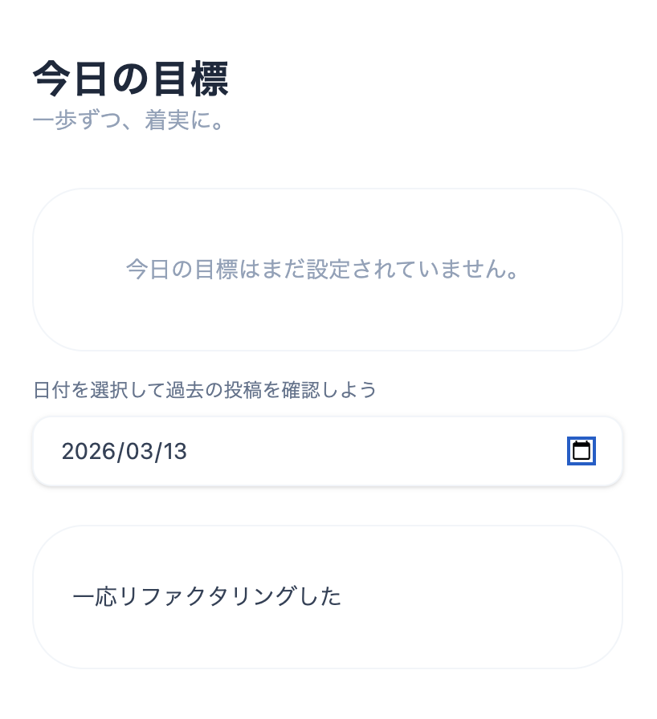

<!-- page:contents -->

[01　作品について](#about)

[02　課題・背景・目標](#context)

[03　制作プロセス](#process)

[04　成果と効果](#outcome)

[05　使用技術・ツール](#tools)

<!-- page:about -->

日々の目標や振り返りを記録するアプリです。日付を選び、過去の投稿を確認する画面を用意しています。

2026年2月に制作。初めて1から設計を考え、自分の手でコーディングした、学びの出発点となった作品です。

[Demoを開く](https://kodo-plum.vercel.app/)

[GitHubを見る](https://github.com/awashimakentaro/kodo)

<!-- page:context -->

## AI任せの状態から抜け出したい

このアプリを作る前は、AIに頼りきりでコードを書いていて、何をしているのか十分に理解できていませんでした。

「アプリはどう作るのか」を、自分で考え、手を動かすことで学び直そうとしました。ER図、SQL、デザイン、コーディング、Gitまで、一つずつ取り組んだ作品です。

## まず、自分で作ったと言えるものを

完璧なプロダクトを作ることよりも、データベースから画面までのつながりを理解し、自分で設計・実装する経験を大切にしました。

使っている技術の名前を知るだけでなく、なぜその処理や構造が必要なのかを考えることが、この制作の目標でした。

<!-- page:process -->

## データの形から、画面まで

データベース設計から始め、テーブル構造とリレーションを考えました。リポジトリのER図には、ユーザー、投稿、タスク、フォロー、いいねの関係を整理しています。

次にAPIのエンドポイントと、フロントエンドをどうつなぐかを設計しました。状態管理や、データを取得して表示する流れも、自分で考えて実装しました。

## 基礎を一つずつ使ってみる

Prismaのスキーマ定義、React Hook FormとZodによるフォーム、SWRによるデータ取得を扱いました。

エラーの扱いとローディング中の表示も含め、画面が完成するまでに必要な基礎を、実際に手を動かして学びました。

<!-- page:outcome -->

## 初めて持てた「自分で作った」実感

コードの意味が分からないままAIに頼る状態から、データベース、API、画面、状態管理を自分で考える経験へ進めました。

ER図やSQL、Gitの使い方も、アプリを形にする流れの中で学びました。完璧には程遠くても、自分で設計して作ったという実感を持てたことが、一番大きな成果です。

## 足りなさも含めて、次の制作へ

当時はuseStateを多用し、構造や実用性にも課題が残りました。元のポートフォリオでは、その未熟さも含めて、一番勉強になった思い出の作品として紹介しています。

完成したことだけでなく、どこを理解できていなかったかを知る機会にもなりました。

<!-- page:tools -->

## 画面・フォーム

- Next.js / React — 画面と状態の実装
- TypeScript — 型を使った開発
- React Hook Form — フォーム管理
- Zod — 入力の検証
- SWR — データ取得

## データ・開発

- Node.js — サーバー側の実装基盤
- PostgreSQL — データベース
- Prisma — スキーマ定義とデータ操作
- ER図 / SQL — データ構造の設計と学習
- Git — 変更の管理
