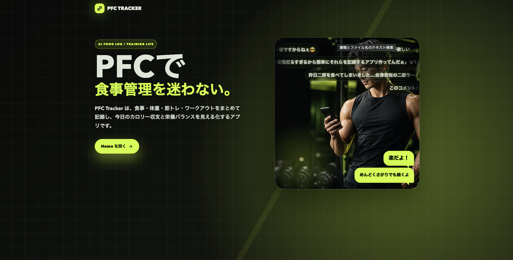

いつもの食事を保存し、ワンタップでその日の記録へ。たんぱく質・脂質・炭水化物（PFC）を、できるだけ手間なく管理するための食事管理アプリです。

画像とAIを使った栄養情報の入力、メニューの保存・再利用を通じて、毎日の記録を楽にすることを目指しました。2026年3月から4月に制作。Web／モバイルに対応しています。

[Demoを開く](https://diet-phi-bay.vercel.app/)

[GitHubを見る](https://github.com/awashimakentaro/diet)
