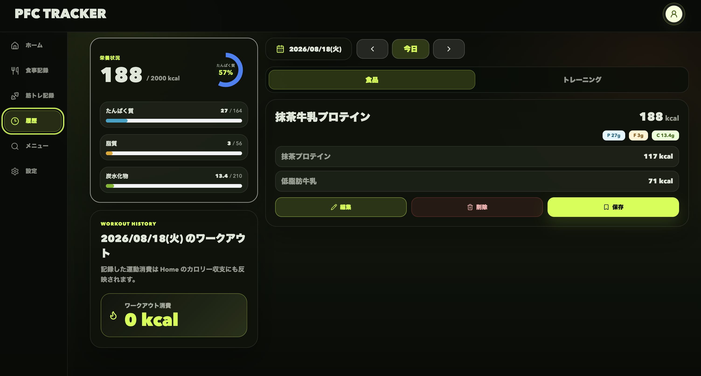

## 作り直しを、設計の学びにする

React／Next.jsの基礎、ルーティング、状態管理を学び直し、機能ごとに責務を分ける構成を取り入れました。

Git運用やコミットの切り方も見直し、保守性と拡張性を考えるようになりました。OSSのコードを読み、出会った開発手法を自分の制作へ反映しています。

Clean ArchitectureやFeature-based設計など、構造から改善する取り組みを続けています。
