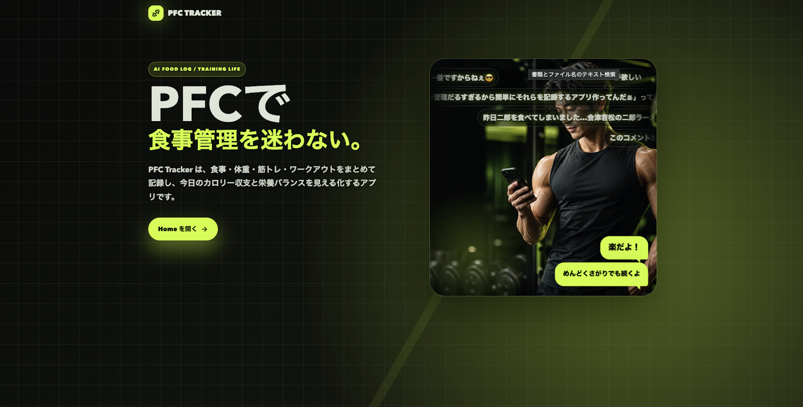
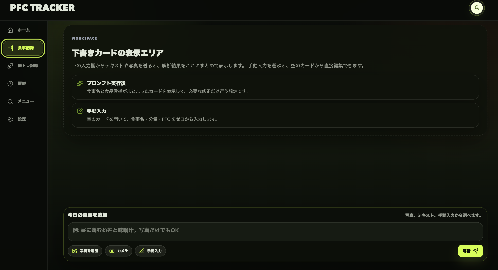

<!-- page:contents -->

[01　作品について](#about)

[02　課題・背景・目標](#context)

[03　制作プロセス](#process)

[04　検証・改善](#review)

[05　成果と効果](#outcome)

[06　使用技術・ツール](#tools)

<!-- page:about -->

いつもの食事を保存し、ワンタップでその日の記録へ。たんぱく質・脂質・炭水化物（PFC）を、できるだけ手間なく管理するための食事管理アプリです。

画像とAIを使った栄養情報の入力、メニューの保存・再利用を通じて、毎日の記録を楽にすることを目指しました。2026年3月から4月に制作。Web／モバイルに対応しています。

[Demoを開く](https://diet-phi-bay.vercel.app/)

[GitHubを見る](https://github.com/awashimakentaro/diet)

<!-- page:context -->

## 筋トレは続けたい。記録の手間は減らしたい

趣味の筋トレに合わせて、食事のPFCをできるだけ楽に管理したい。それが制作のきっかけです。食品ごとの栄養情報をブラウザーで調べる手間や、日々の記録をもっと効率化したいと考えました。

## いつもの食事は、入力し直さない

普段の食事は、ある程度決まっています。一度登録した料理とPFCをライブラリに保存し、次からはワンタップでその日の食事へ記録できる形にしました。

新しく登録する食品も、画像とAIを使って栄養情報を整理する。調べる手間と、同じ内容を繰り返し入力する手間を減らし、気軽に食事を記録したい人のためのアプリを目指しました。

<!-- page:process -->

## 入力から、記録の再利用まで

食品の画像を送ると、ChatGPTのAPIを通じてPFCの数値を受け取り、食品やメニューの登録につなげます。栄養情報を自分で調べて入力する負担を減らすために取り入れました。

よく食べる料理はライブラリに保存。次に食べたときはワンタップでその日の記録へ追加し、摂取量を確認できるようにしています。

<!-- page:process-structure -->

## 初めてのことを、取り入れながら作る

新しい技術や設計を調べ、取り入れながら開発を進めました。多くが初めての経験で、動くものを作れても、その実装が適切なのか、自分では判断しきれない難しさがありました。

AIの出力を理解して改善するために、React／Next.jsの基礎、状態管理、コードの構成やGit運用を学び直しました。OSSのコードも読み、自分の制作を見直す材料にしています。

## 今も、整えていく途中

コードの整理や設計には、まだ改善したい部分が残っています。完成された設計を最初から実現できたわけではありません。使う人の体験を改善しながら、自分で実装を理解し、判断できる範囲も広げていく。その両方に取り組んだ制作です。

<!-- page:review -->

## UIの統一

画面ごとに揃っていなかったUIを見直し、全体の統一感を整えました。

## 読み込み時の揺れを改善

スケルトンを先に表示し、内容の読み込みで画面が揺れるような見え方を抑えました。

## 食事管理に絞る

食事管理に目的を絞り、筋トレ機能を削除。アプリの一貫性を優先しました。

## 初回の使い方を案内

登録後の初回ログインで使い方を案内。初めての人が迷わず始められる仕組みを用意しました。

<!-- page:outcome -->

## 毎日の記録にかかる時間が減った

自分で使う中で、以前よりも食事管理が楽になり、1日の食事を記録する時間が減ったと感じています。よく食べる料理を保存して再利用する仕組みを、自分の日常で役立てられました。

## 1か月の食事管理で記録した変化

アプリを使いながら食事管理に取り組んだ1か月で、体重は2kg減り、体脂肪率は約2ポイント下がりました。これは自分自身の利用記録であり、アプリだけによる効果を示すものではありません。

## 作って、使って、改善する学び

使われ方を観察してUIを見直す経験と、AIの出力を理解して改善するための基礎学習。その両方を通じて、動くものを作るだけでなく、使い続けやすい形へ育てることを意識するようになりました。

<!-- page:tools -->

## Web・モバイル

- Next.js / React — Web画面とAPI Routes
- TypeScript — 型を使った実装
- Expo / React Native — モバイルアプリ
- Expo Router — モバイルの画面遷移
- React Hook Form / Zod — フォームと入力検証
- SWR / Zustand — データ取得と状態管理

## データ・UI

- Supabase Auth — 認証
- PostgreSQL / Prisma — データ管理
- Tailwind CSS / Radix UI — 画面部品
- Framer Motion — UIアニメーション

<!-- page:tools-quality -->

## 品質と運用

- Google Analytics — 利用行動・離脱の確認
- Playwright — E2Eテスト
- GitHub Actions — CI
- Pino — 構造化ログ
- Sentry — 例外監視
- Git / GitHub — コード・変更の管理
- Xcode / EAS Build — モバイルのビルド

[制作中の振り返りを読む（Qiita）](https://qiita.com/awashimakentaro/private/8feb5597d26ec907dc4b)
