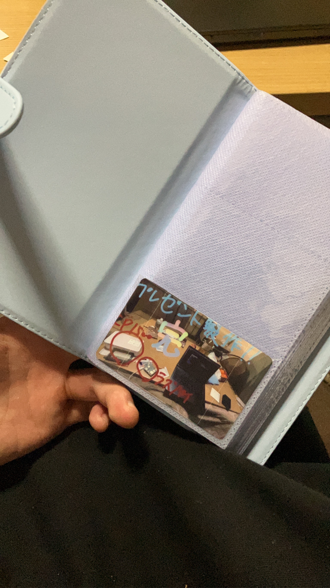

大切な人に「思われている」安心感を届けるIoTギフトです。スマホから送った画像をRaspberry Piが受け取り、Canon SELPHY CP1500でチェキサイズに印刷します。

返信やアプリの操作を求めず、紙として手に取れる形で、気持ちを届けることを目指しました。

[動作デモを見る](https://www.youtube.com/shorts/9xW-BIbZ5RM)

[GitHubを見る](https://github.com/awashimakentaro/Presence-Note)
