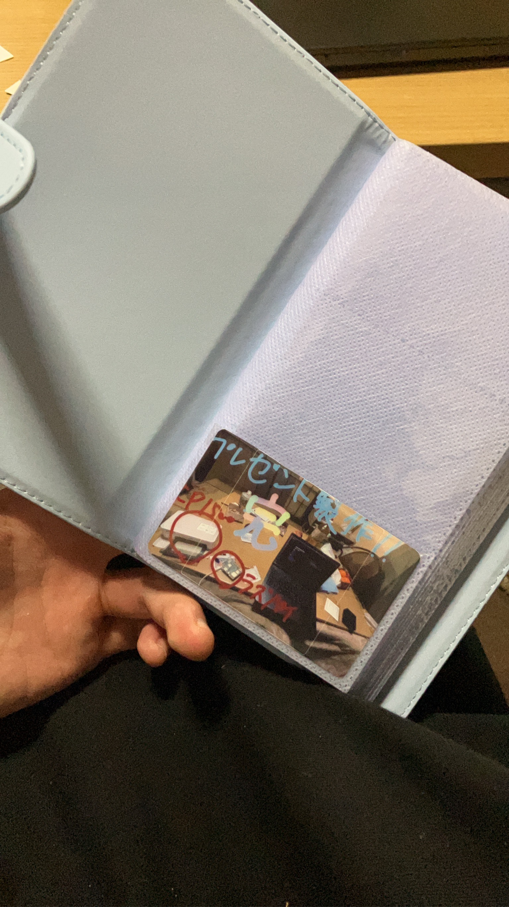

<!-- page:contents -->

[01　作品について](#about)

[02　課題・背景・目標](#context)

[03　制作プロセス](#process)

[04　成果と効果](#outcome)

[05　使用技術・ツール](#tools)

<!-- page:about -->

大切な人に「思われている」安心感を届けるIoTギフトです。スマホから送った画像をRaspberry Piが受け取り、Canon SELPHY CP1500でチェキサイズに印刷します。

返信やアプリの操作を求めず、紙として手に取れる形で、気持ちを届けることを目指しました。

[動作デモを見る](https://www.youtube.com/shorts/9xW-BIbZ5RM)

[GitHubを見る](https://github.com/awashimakentaro/Presence-Note)

<!-- page:context -->

## 離れていても、思いを手元へ

大切な人と離れている時間にも、思い出した気持ちを届けたい。デジタルな通知だけでなく、手で触れられ、持ち歩けるものとして残したいと考えました。

スマホで画像と一言を送り、相手の家にあるプリンターから印刷する。受け取る人は返信も操作もせず、その紙を手に取れます。

## 便利さよりも、受け取り方を

紙をデコレーションしたり、ホルダーに入れて持ち歩いたりできることも、体験の一部です。

「持って触れる安心感」を届けるという設計意図から、通知を増やすのではなく、静かに印刷する構成を選びました。

[制作背景をQiitaで読む](https://qiita.com/awashimakentaro/private/8a3ead271d6618884c55)

<!-- page:process -->

## 送る、受け取る、印刷する

スマホからntfyへ画像を送り、Raspberry Piが受信します。画像処理を通して、CUPSからプリンターへ印刷を依頼する、直列の流れにしました。

受信・画像処理・印刷を別のモジュールへ分け、それぞれの役割を明確にしています。

## 送る側も、受け取る側もシンプルに

ntfyはスマホからすぐに送信でき、Raspberry Pi側はHTTP／SSEで受け取れることから採用しました。通知システムや別のサーバーを作り込まずに、必要な流れを用意するための選択です。

常駐運用にはsystemdを使い、起動後も受信を待ち続ける構成にしています。

<!-- page:process-paper -->

## プリンター選びも、体験の設計

最初はレシートプリンターも検討しました。しかし、欲しかったのは業務用のレシートのような印象ではなく、チェキのように手元へ残したくなる質感でした。

そこでCanon SELPHY CP1500を選びました。Raspberry PiからCUPSとAirPrint／IPPを通して制御できることも、選定時に重視しています。

## 紙の手触りを優先する

メッセージの意味を分析したり、相手に反応を求めたりする機能は、この体験の中心ではありません。

思い立った瞬間に送り、受け取った人が自分のペースで手に取る。その静かな届け方を大切にしました。

<!-- page:outcome -->

## 気持ちを、手に取れる形へ

スマホから送った画像を、離れた場所のRaspberry Piで受け取り、プリンターで紙へ出力する流れを形にしました。元のポートフォリオには、印刷した写真とホルダーの実物写真を掲載しています。

## 小さな仕組みに、体験の意図を込める

ソフトウェアとしてはシンプルな直列処理でも、紙の質感や返信を求めない設計を選ぶことで、届けたい体験を表現しました。

安心感を実際にどれだけ高めたかを測定したものではなく、大切な人へ届けたい思いから設計した作品です。

<!-- page:tools -->

## ソフトウェア

- Python — 受信・画像処理・印刷の連携
- ntfy / SSE — 画像付きメッセージの受信
- Pillow — 印刷前の画像処理
- CUPS / AirPrint・IPP — 印刷制御
- systemd — 常駐と起動管理

## ハードウェア

- Raspberry Pi 4 — 画像の受信と処理
- Canon SELPHY CP1500 — 写真の印刷
- Wi-Fi — ネットワーク接続

[設計・実装の記事を読む](https://qiita.com/awashimakentaro/private/8a3ead271d6618884c55)
