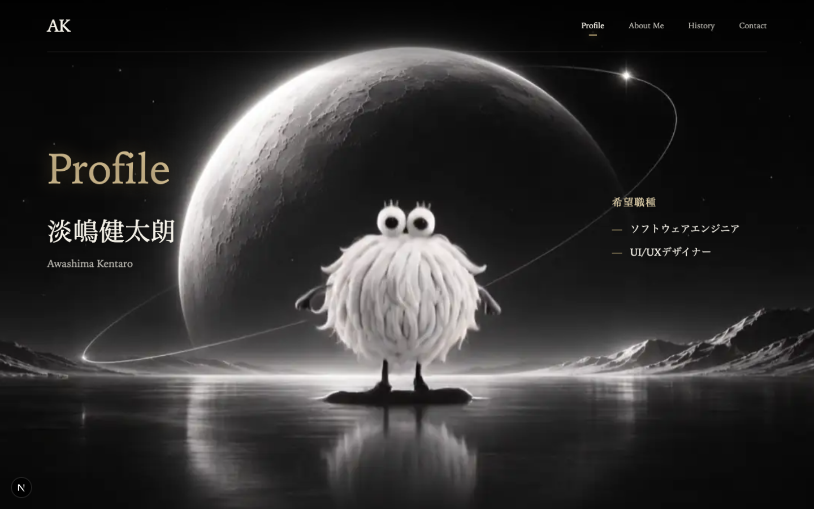

# 作品について

自己表現をコンセプトに、背景映像と3Dブックで自分の歩みを紹介するポートフォリオです。いつ、何に取り組んだのかを本ごとに辿れる見せ方と、調査に基づく情報設計を組み合わせ、面白さと実用性の両立を目指しました。

約1か月で制作。企画・調査・Figmaデザイン・素材制作・実装を、AIも活用しながら自分で担当しました。

[Demoを開く](https://portfolio-silk-two-49.vercel.app)

[GitHubを見る](https://github.com/awashimakentaro/Portfolio)
