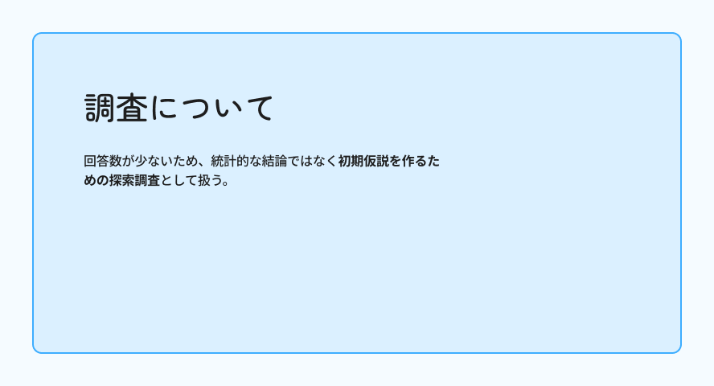

## 調査から設計の手がかりを得る

ユーザー調査をFigJamで整理しました。回答が少ないため、統計的な結論ではなく、改修のための初期仮説として扱っています。

「何ができる人か」「本人の担当範囲」が伝わるよう、作品で紹介する情報と配置を見直しました。

[FigJamで調査資料を見る](https://www.figma.com/board/lGrxpA1j662PE1GgPRcdNl/?node-id=1-10)
