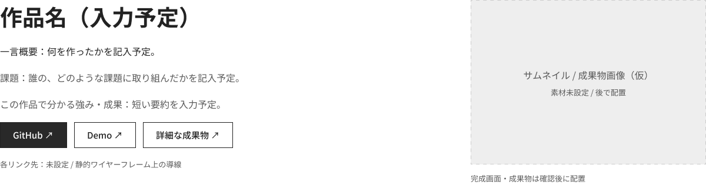

## 別ページから、共通の本へ

当初は作品詳細・インターン詳細を別ページにする構想でした。ただ、背景演出を含む実装コストと、体験の一貫性に懸念がありました。

そこで、共通テンプレートの本に、それぞれの作品・経験に合う内容を載せる形へ。画像は当初の情報配置を検討したワイヤーで、仮の文章・画像枠を含みます。

[Figmaでワイヤーフレームを見る](https://www.figma.com/design/bLIPCT8iZ0oqBqVApCB0L6/Wire-Frame?node-id=43-1679)
