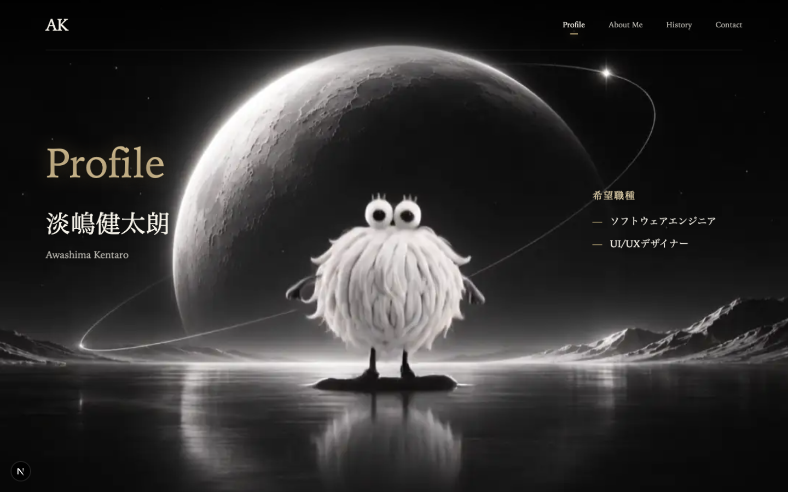
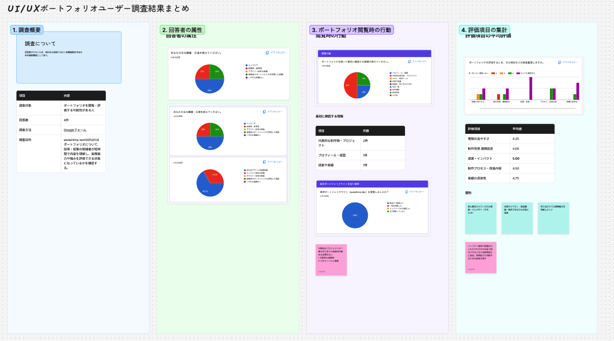

<!-- page:contents -->

# 目次

[01　作品について](#about)

[02　課題・背景・目標](#context)

[03　制作プロセス](#process)

[04　検証・改善](#review)

[05　成果と効果](#outcome)

[06　使用技術・ツール](#tools)

<!-- page:about -->

# 作品について

自己表現をコンセプトに、背景映像と3Dブックで自分の歩みを紹介するポートフォリオです。いつ、何に取り組んだのかを本ごとに辿れる見せ方と、調査に基づく情報設計を組み合わせ、面白さと実用性の両立を目指しました。

約1か月で制作。企画・調査・Figmaデザイン・素材制作・実装を、AIも活用しながら自分で担当しました。

[Demoを開く](https://portfolio-silk-two-49.vercel.app)

[GitHubを見る](https://github.com/awashimakentaro/Portfolio)

<!-- page:context -->

旧サイトでは、採用側に志望職種・強み・担当範囲が伝わりにくいことが課題でした。

キャラクターと宇宙らしさを残し、紹介項目と成果物への導線を統一する方針へ。

実回答3件＋仮想回答1件の探索的調査。改修後の効果検証は今後行います。

[FigJamで調査の全体を見る](https://www.figma.com/board/lGrxpA1j662PE1GgPRcdNl/?node-id=0-1)

<!-- page:process -->

## 01 企画・要件定義

目的・対象者・必要機能を要件定義書へ。

## 02 ユーザー調査・課題整理

フォーム調査で得た課題をFigJamへ。

## 03 機能・情報設計

紹介項目と成果物への導線を設計。

## 04 ユーザーフロー・操作設計

知る順序と、次の操作を整理。

## 05 ワイヤーフレーム制作

Figmaで情報配置を下書き。

## 06 UI・ビジュアルデザイン

世界観・配色・文字・本の見せ方を設計。

<!-- page:process-after -->

## 07 プロトタイプ制作・検討

Figma Makeで試作し、本の選び方を検討。

## 08 Web・3D演出実装

連番映像・3Dブック・UIを実装。

## 09 公開・ユーザーテスト

公開後、読み込み・操作への意見を受領。

## 10 分析・改善

意見を受けて取得・移動を改善。再評価は今後。

## 11 ケーススタディ作成

整理中：工程・判断・学びを本と資料集へ。

[工程の資料集を見る](https://github.com/awashimakentaro/Portfolio/tree/main/docs/process-notes/awashima-portfolio)

<!-- page:review -->

## 「待つ」体験を見直す

公開後、「ロード画面は短くても待たされる感じがする」という意見がありました。まず映像取得を968通信から8区間へ集約。キャラクターを先に見せる案は、今後の検討として残しました。

## 見たい速さで、先へ進めるように

「UIは良いが、スクロールしても進めず全体を見づらい」という指摘も。映像の終了を待たず、再生中も次へ進めるよう変更。戻る際の移動映像は省き、前進の演出は残しました。

## 世界観と、使いやすさの両立

背景とキャラクターを一体の映像へ作り直し、文字・本の登場も調整。自己確認に加え、他の方の意見を改善へつなげました。改善後の利用者による再評価はこれからです。

[改善の詳細を読む（Notion）](https://www.notion.so/411c38da45208116a48be1e6769dff4e)

[公開の改善記録を見る（GitHub）](https://github.com/awashimakentaro/Portfolio/blob/main/docs/process-notes/awashima-portfolio/source/10_%E5%88%86%E6%9E%90%E3%83%BB%E6%94%B9%E5%96%84/2026-11-08-initial-feedback.md)

<!-- page:outcome -->

## 取得処理を、約7.8秒短縮

開発環境での全映像取得は、10.009秒から2.169秒へ。各1回・キャッシュ条件が異なる比較で、利用者の体感速度を測った数値ではありません。

## 意見を、操作の改善へつなげる

再生中も先へ進め、戻るときは移動映像を省く形へ。世界観を残しながら、閲覧者の操作を優先しました。旧サイトとの比較や利用者の再評価は今後行います。

## 自分らしさと、判断する力

自分の歩みと世界観を形にできました。ワイヤーフレームで情報を整理する大切さと、AIへ任せる前に技術を調べて選ぶ力を学びました。

<!-- page:tools -->

- Figma / FigJam
- Kling
- React / Next.js
- TypeScript
- Three.js / React Three Fiber
- React Spring
- ChatGPT / Codex
- WebP / Canvas
- Markdown
