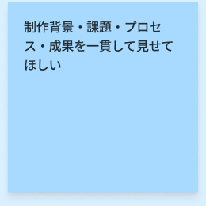
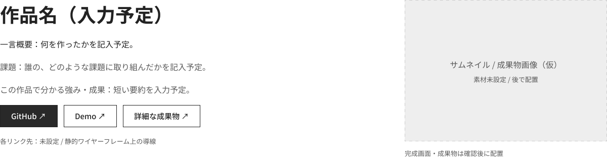
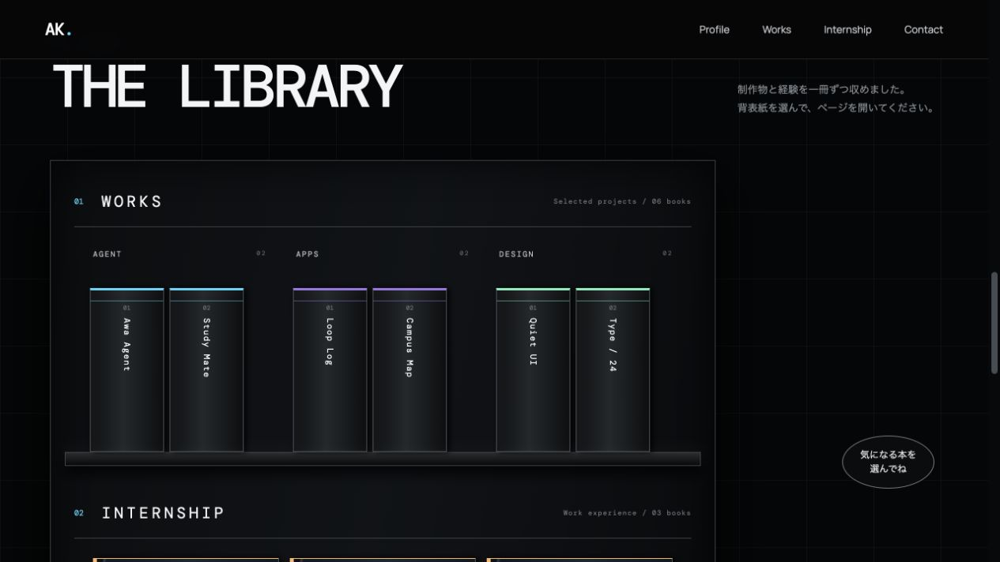

<!-- page:contents -->

# 目次

[01　作品について](#about)

[02　課題・背景・目標](#context)

[03　制作プロセス](#process)

[04　検証・改善](#review)

[05　成果と効果](#outcome)

[06　使用技術・ツール](#tools)

<!-- page:about -->

# 作品について

背景映像と3Dブックで作品や経験を紹介するポートフォリオです。自分らしい世界観と、調査に基づく配置・デザインを組み合わせ、面白さと実用性の両立を目指しました。

約1か月で制作。企画・調査・Figmaデザイン・素材制作・実装を、AIも活用しながら自分で担当しました。

[Demoを開く](https://portfolio-silk-two-49.vercel.app)

[GitHubを見る](https://github.com/awashimakentaro/Portfolio)

<!-- page:context -->

調査から、本人の強みや担当範囲が伝わりにくい課題を整理。世界観を保ちながら、作品情報と成果物への導線を揃えることを目指しました。

4件中1件は仮想回答を含みます。集計は探索的な仮説で、改修後の効果ではありません。

[FigJamで調査の全体を見る](https://www.figma.com/board/lGrxpA1j662PE1GgPRcdNl/?node-id=0-1)

<!-- page:process -->

紹介する情報を揃え、世界観と分かりやすさを組み合わせる方針へ。

[制作過程・判断の記録を読む](https://github.com/awashimakentaro/Portfolio/tree/1280cbced472dcf8b9cb1eaa138e9b71e42b3069/docs/process-notes/awashima-portfolio)

<!-- page:process-wireframe -->

## 情報の優先順位を決める

作品の概要、課題、本人の強み、成果物へのリンクをどう並べるか検討した設計資料です。記入予定の文章や仮の画像枠を含みます。

当初の独立した詳細ページ案をそのまま実装せず、紹介する情報を現在の3Dブックの構成へ整理しました。

[Figmaでワイヤーフレームを見る](https://www.figma.com/design/bLIPCT8iZ0oqBqVApCB0L6/Wire-Frame?node-id=43-1679)

<!-- page:process-prototype -->

## 操作検討用プロトタイプ

Figma Makeで制作したプロトタイプです。本棚から表紙を選び、詳細を開き、ページを切り替える流れを試せます。

画面内の作品名や本文は試作用のサンプルです。現在のポートフォリオとは構成・見た目が異なります。

[プロトタイプを操作する](https://cherry-side-73808919.figma.site)

<!-- page:review -->

# 検証・改善

## 情報の伝わり方

調査を受け、作品を共通項目で紹介する本の構成と、成果物への導線を見直しました。

## 見た目と操作

実画面を見ながら、映像の境界、ループ時の拡大や余白、文字や本の登場タイミングを繰り返し調整しました。

本の開閉・めくり・画面移動をブラウザーで確認し、閉じるときの揺れや、背景より先に本が現れる違和感も修正しています。

改修後の利用者評価と、定量的な効果測定はまだ実施していません。

<!-- page:outcome -->

# 成果と効果

## できるようになったこと

背景とキャラクターを一体のフレームとして扱い、想像した動きをスクロール操作につなげる方法を理解できました。Figmaでの情報・画面設計を、Webと3Dの操作へつなげる経験を積みました。

## 今後の検証

公開後のユーザー調査・A/Bテスト、数値による改善効果の検証は、まだ実施していません。

実施後に、条件・観察結果・改善点をまとめたFigJamや資料をこの章へ追加します。

<!-- page:tools -->

## デザイン・映像制作

- Figma — ワイヤー・UIデザイン
- FigJam — 調査・情報整理
- Kling — キャラクターの動画生成

## Web・3D

- React / Next.js — 画面・UI
- TypeScript — データ・型の管理
- Three.js / React Three Fiber — 本の3D描画
- React Spring — 開閉・ページめくり

## 制作・コンテンツ管理

- Codex — 実装支援
- WebP / Canvas — 映像の連番再生
- Markdown — 本文・制作メモ
